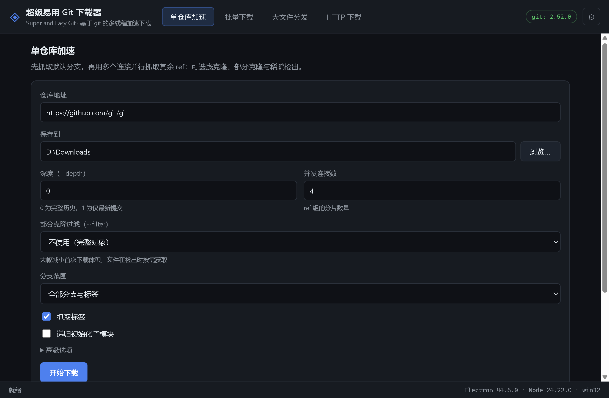

<div align="center">
  
  <h1>超级易用 Git 下载器</h1>
  <p><b>Super and Easy Git</b> —— 基于 git 的多连接下载器（Windows 桌面 GUI + 命令行）</p>
  <p>
    <a href="https://github.com/Vantasi-Imilus/super-and-easy-git/actions/workflows/ci.yml"></a>
    
    
    = 20">
  </p>
</div>



## 它是什么

一个把 **git 本身当成下载引擎** 的图形化下载器：不做协议层面的重新实现，而是驱动你本机的
`git` 二进制，在它之上叠加多连接调度、并行分组、进度聚合与断点续传。四种模式覆盖从「拉一个仓库」
到「分发一个大文件」的常见场景：

| 模式 | 解决的问题 | 关键手段 |
| --- | --- | --- |
| **单仓库加速** | 克隆大仓库又慢又卡 | 默认分支先行 + N 路并行抓取互斥 ref 组，可选浅克隆 / 部分克隆 / 稀疏检出 |
| **批量下载** | 一次拉几十个仓库 | 仓库级并发队列 + 单仓库加速 + 失败退避重试 |
| **大文件分发** | 用 git 仓库当分发通道 | 文件切片推送到 `dl/shard-*` 分支，拉取端多连接并行取分片并逐片校验 |
| **HTTP 下载** | 普通文件的多线程下载 | Range 分段并行 + 断点续传，不支持 Range 时自动回退单连接 |

界面为简体中文；代码、注释与提交信息为英文。

## 为什么快

- **默认分支先行**：先单独抓取默认分支（用户最想要的可用状态），再并行抓取其余 ref 组，
  每组一条独立连接；分组互斥，并发 `git fetch` 不会争抢同一个 ref。
- **浅克隆的并行**：git 的 `.git/shallow` 由 `shallow.lock` 全程加锁，同仓库并发浅克隆会直接失败；
  因此浅克隆模式下每个 ref 组先下载到独立的临时裸仓库（各自持锁、真正并行），再串行合并进目标仓库。
- **锁冲突自动回退**：一旦遇到 `cannot lock ref` / `index-pack failed` / `shallow file has changed`
  等并发竞争特征，自动降级为单连接重试剩余 ref，保证最终结果正确。
- **诚实的进度**：解析 git `--progress` 的真实输出并按 worker 聚合；进度以对象数计，
  速度逐连接累加，拿不到速度时不编造数字。
- **断点续传**：单仓库 / 批量模式依赖 git 的增量 fetch；HTTP 模式保留 `.part` 与元数据
  （按 ETag / 大小校验）；大文件模式按分片记录完成度，重跑只补缺失分片。

## 下载与安装

1. 到 [Releases](https://github.com/Vantasi-Imilus/super-and-easy-git/releases) 下载最新
   `Super-and-Easy-Git-Setup-x.y.z.exe`；
2. 双击安装（按用户安装，无需管理员权限，可自选安装目录）；
3. 桌面 / 开始菜单会出现「超级易用 Git 下载器」。

> **首次运行提示**：安装包未做代码签名，Windows SmartScreen 会拦截提示，
> 点「更多信息 → 仍要运行」即可。自行签名的配置见下文「打包」。

从源码运行（开发）：

```sh
npm install        # 若 Electron 二进制下载困难，见「打包」一节的镜像设置
npm start          # 启动 GUI
```

环境要求：Windows 10/11（安装包目标平台）；源码运行需 Node.js ≥ 20 与本机可用的 `git`
（开发环境为 git 2.52，程序会在启动时探测 git 能力并按需降级）。

## 快速开始（GUI）

1. 打开「单仓库加速」页，填入仓库地址（支持 https / ssh / `user@host:path`）；
2. 选择保存目录，按需设置深度（`--depth`）与部分克隆过滤（`--filter`）；
3. 点「开始下载」，任务卡片会显示逐连接的进度、速度与日志；
4. 中断没关系：再次点「继续」会增量续传。

## 命令行

GUI 之外的同一套引擎：

```sh
node bin/gitdl.js detect
node bin/gitdl.js single https://github.com/user/repo.git --depth 1 --filter blob:none --jobs 4
node bin/gitdl.js batch repos.txt --concurrency 3 --depth 1
node bin/gitdl.js http https://example.com/file.iso --concurrency 8
node bin/gitdl.js bigfile-push ./dataset.bin --repo git@github.com:user/channel.git --shards 8
node bin/gitdl.js bigfile-pull git@github.com:user/channel.git --file dataset.bin --out ./dataset.bin
```

## 四种模式详解

### 1. 单仓库加速

`git init` → 抓取默认分支 → 并行抓取其余 ref 组 → 检出 → （可选）递归初始化子模块。
可选旋钮：`--depth`、`--filter`（`blob:none` / `tree:0` / `blob:limit=1m`）、仅默认分支、
是否抓标签、检出指定分支/标签/提交。重跑即续传。

### 2. 批量下载

粘贴仓库列表（每行一个，`#` 为注释），设置并发仓库数与每仓库连接数；
单个仓库失败会按指数退避重试，最终逐条报告成功/失败与原因。

### 3. 大文件分发（git 作为分发通道）

- **发布**：文件按 32 MiB 切片（低于 GitHub 单文件 100 MiB 硬限），用 plumbing
  （`hash-object` / `mktree` / `commit-tree`）生成 `dl/manifest` 与 `dl/shard-*` 分支后强制推送；
- **拉取**：并行 fetch 各分片分支（每个分支独立连接与 pack），逐分片校验 sha256 与对象 ID，
  按偏移写入 `.part`，最后整体校验后改名。

> 注意：这是**传输通道**而非 CDN——仓库体积会随发布版本增长，且会强制更新 `dl/*` 命名空间下的分支，
> 请勿在那些分支名有其它含义的仓库上使用；发布内容对仓库的读者可见，禁止用于机密数据。

### 4. HTTP 下载

HEAD 探测（大小 / Range / ETag）→ 分段计划 → N 段并发 Range 下载写 `.part` +
`.meta` → 续传校验 → 合并（可选 sha256 校验）。服务器对 Range 请求返回 200 时自动回退单连接。
文件名取自 Content-Disposition / URL 并做消毒，杜绝路径穿越。

## 开发

```
bin/gitdl.js              CLI（与 GUI 同一引擎）
src/main/                 Electron 主进程：窗口、IPC、任务宿主、设置
src/preload.cjs           contextBridge API（渲染层唯一的出口）
src/engine/               纯 Node 引擎（零 Electron 依赖，可单测）
src/renderer/             界面：路由、四个模式视图、共享组件
test/                     node --test 测试套件（全部本地夹具，离线可跑）
tools/                    图标生成与截图脚本
assets/ build/            图标源文件与打包资源
```

```sh
npm test            # 66 个测试，全部使用本地 file:// 仓库与本地 HTTP 服务器夹具，无需网络
npm start           # 开发运行
npm run gitdl -- single <url> --depth 1     # CLI
GITDL_SMOKE=1 npx electron .                # 无头验收自检（退出码 0 = 通过）
```

大文件模式的 1 GiB 往返验收测试由环境变量门控：`GITDL_BIG=1 npm test`。

### 打包

```sh
npm run build:installer   # 生成 dist/Super-and-Easy-Git-Setup-<version>.exe
npm run build:dir         # 只生成免安装目录 dist/win-unpacked（快速验证）
npm run icon              # 由 assets/icon.svg 重新生成图标 PNG
npm run screenshot        # 重新生成 docs/screenshot.png
```

- 打包使用 `npm install` 已装好的 Electron（`electronDist` 配置），不会重复下载官方 zip；
- 首次构建需下载 NSIS 工具链，若 GitHub Releases 不通可换镜像：
  `ELECTRON_BUILDER_BINARIES_MIRROR=https://npmmirror.com/mirrors/electron-builder-binaries/ npm run build:installer`；
- **代码签名**：仓库不带证书，安装包默认未签名。自行签名可在 `build.win` 中配置
  `certificateFile` / `certificatePassword`（或使用 CI 中的签名服务）。

## 设计取舍与已知限制

- **不重实现 git 协议**：所有 git 操作都调用本机 `git`，能力在运行时探测（`git clone -h` 等），
  版本不足时自动跳过对应特性。
- **凭据交给 git**：SSH agent / credential helper / 代理均沿用你本机 git 的配置，
  本程序不存储任何口令；设置面板里的代理与镜像重写是可选加速手段，默认不启用。
- **浅克隆 + `--filter` 组合会退化为串行**：promisor 对象无法经临时仓库路由，此时并行会破坏对象获取路径。
- **进度口径**：git 只报对象数不报字节，界面上的百分比是对象占比；速度缺失时会标注为部分值。
- 未包含（v1 范围外）：仓库发现/浏览、Git LFS、自动更新、托盘常驻。

## 许可

[GPL-2.0](LICENSE)。最初在 [git.git](https://github.com/git/git) 的 `contrib/` 下开发，
因此沿用了与 git 项目一致的许可证。

---

## English

**Super and Easy Git** is a GUI (Electron) multi-connection downloader built *on* git — it drives the
real `git` binary and adds scheduling, parallelism, progress aggregation and resume on top. Four modes:
single-repo acceleration (default branch first, then disjoint ref groups over N connections, with shallow
/ partial / sparse options), batch clone, big-file distribution over per-shard git branches
(`dl/manifest` + `dl/shard-*`, chunk-verified), and a plain HTTP Range-segmented downloader.

Shallow clones are parallelized by downloading each group into its own temporary bare repository
(git's `shallow.lock` forbids concurrent shallow updates in one repo) and merging groups serially;
ref-lock races trigger an automatic single-connection fallback. Progress is object-based and never
fabricates byte counts. Credentials are delegated to git; the app stores none.

```sh
npm install && npm start          # GUI (Chinese UI)
npm test                          # 66 offline tests (local file:// and HTTP fixtures)
node bin/gitdl.js single <url> --depth 1 --filter blob:none --jobs 4
```

Requires Node.js ≥ 20 and a git binary (tested with 2.52). Licensed GPL-2.0.
